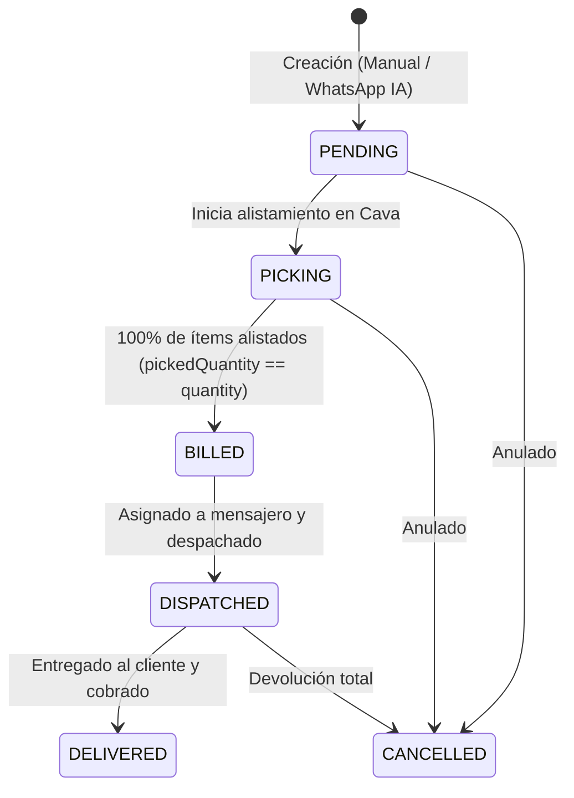

# ESPECIFICACIÓN MAESTRA DE REGLAS DE NEGOCIO Y ARQUITECTURA DE MICROSERVICIOS
## Plataforma Industrial Despulpadora (PWA ERP + Backend Microservicios)

> **Propósito de este documento:**
> Este archivo consolida todas las reglas de negocio, flujos operativos, modelos de datos, validaciones y arquitectura de microservicios desarrollados en la aplicación frontend (PWA). Sirve como la guía técnica definitiva para construir las APIs y microservicios del backend en .NET / C# (o la tecnología elegida), asegurando una paridad del 100% con el flujo actual sin romper ninguna funcionalidad.

---

## 1. VISIÓN GENERAL DEL SISTEMA Y DOMINIOS

El sistema gestiona de extremo a extremo una planta agroindustrial de pulpas de fruta congeladas:
1. **Producción**: Recepción de fruta fresca, cálculo de merma y rendimiento, empaque por gramajes y loteo.
2. **Almacenamiento y Cava**: Inventario en dos niveles: Fruta fresca (Kg) y Pulpa congelada por presentación (140g, 250g, 500g, 1000g).
3. **Alistamiento Cava (KDS)**: Pantalla táctil / TV de picking en cava para congeladores, con timers, alertas sonoras y prioridad urgente.
4. **Ventas y Pedidos**: Toma manual o vía WhatsApp (mensajes de voz procesados con IA), programación de entregas por día.
5. **Logística y Despacho**: Mapa satelital interactivo, optimización de rutas, control de domiciliarios, validación de facturación antes de asignación y cuadre de caja (liquidación de rutas).
6. **Recursos Humanos y Nómina**: Turnos de operarios en planta, liquidación quincenal conforme a normativa laboral colombiana.
7. **Finanzas y Metas**: Control de egresos, arqueo de caja por domiciliario y KPIs de cumplimiento de ventas.
8. **Seguridad (RBAC)**: Roles y permisos granulares por módulo, operación y acción.

---

## 2. REGLAS DE NEGOCIO ESTRICTAS (INVIOLABLES)

### R1. Ciclo de Vida y Transiciones del Pedido
Un pedido (`Order`) atraviesa estrictamente los siguientes estados:



* **`PENDING` (Pendiente)**: Pedido registrado, asignado a un día de la semana (`scheduledDay`: Lunes, Martes, etc.) y a una fecha de entrega.
* **`PICKING` (En Alistamiento Cava)**: Operario en cava selecciona ítems. Cada ítem tiene `pickedQuantity` vs `quantity`.
* **`BILLED` (Facturado)**: Cuando todos los ítems del pedido alcanzan su cantidad completa (`allDone = true`), el pedido pasa automáticamente a `BILLED` (`isBilled = true`).
* **`DISPATCHED` (En Ruta de Despacho)**:
  * **REGLA DE ORO DE INVENTARIO:** En el instante en que el pedido pasa a `DISPATCHED`, el sistema DEBE descontar de forma atómica el stock de pulpa congelada según el gramaje de cada ítem (`g140`, `g250`, `g500`, `g1000`).
* **`DELIVERED` (Entregado con Éxito)**: El domiciliario entrega el pedido. Se registra el método de pago real con el que canceló el cliente.
* **`CANCELLED` (Cancelado)**: Si un pedido cancelado ya estaba en `DISPATCHED`, el microservicio de inventario DEBE reintegrar las unidades descontadas.

---

### R2. Alerta de Prioridad Urgente (`isPriority`)
* **Activación**: Puede solicitarse desde el módulo de Logística / Despacho (botón `[⚡ Prioridad]` en cada tarjeta de entrega o desde el banner de advertencia).
* **Comportamiento en KDS (Cava)**:
  * La tarjeta del pedido en KDS DEBE cambiar su borde a rojo intenso (`border: 2px solid #ef4444 !important;`).
  * En la parte superior de la tarjeta se despliega el banner de alerta:
    `"⚡ URGENTE · PRIORIDAD ALTA — Alistamiento prioritario solicitado desde Despacho / Entregas"`.
  * La alerta se transmite en tiempo real vía WebSockets / SignalR a todas las pantallas de cava activas.
* **Comportamiento en Mapa de Entregas**:
  * La tarjeta del pedido en el panel lateral se bordea en rojo (`is-priority`) y el botón `[⚡]` se ilumina en rojo pulsante.

---

### R3. Regla de Facturación Previa para Asignación de Mensajero
* **REGLA INVIOLABLE:** Un pedido **NO puede ser asignado a un mensajero** si no está facturado (`isBilled == false`).
* **Mecanismo de Bloqueo**:
  * Si el despachador selecciona un mensajero en el dropdown o arrastra el pedido sobre la pastilla/avatar de un mensajero:
    1. Se rechaza la asignación.
    2. El dropdown regresa inmediatamente a `"Sin mensajero"`.
    3. Se muestra un **Banner de Alerta Informativo durante 10 segundos** con barra de cuenta regresiva decreciente.
    4. El banner advierte: *"El pedido [PED-XXXX] no se puede asignar porque aún no está facturado (está en cava)."*
    5. El banner incluye un botón directo de acción: **`[⚡ Solicitar Prioridad]`**, que marca el pedido como prioritario en KDS inmediatamente.

---

### R4. Liquidación de Ruta y Cuadre de Caja de Domiciliarios (Settlement)
* Cada domiciliario tiene un estado en tiempo real: `'en_planta'`, `'en_ruta'`, `'entregando'`, `'por_recibir'`.
* **Cierre de Ruta**: Cuando un domiciliario entrega todas sus paradas asignadas, entra en estado **"Por Recibir"** (`isCourierReadyToReceive = true`).
* **Modal de Arqueo y Recepción**:
  * Lista cada parada de la ruta con su valor.
  * Valida si fue entregada o no (`getEffectiveStopDelivered`).
  * Registra el desglose de pago recaudado por pedido: `EFECTIVO`, `NEQUI`, `BANCOLOMBIA` o `CRÉDITO`.
  * Calcula en vivo:
    $$\text{Total Recaudo} = \sum \text{Valor de entregas realizadas}$$
    $$\text{Efectivo a Entregar en Caja} = \sum \text{Pagos en Efectivo}$$
  * Genera el **Vale / Comprobante de Caja** imprimible con número de planilla, fecha, hora, placa del vehículo y firma.
  * Al confirmar, se liberan las paradas, se cierran las órdenes y el mensajero queda listo para una nueva ruta.

---

### R5. Calculadora de Rendimiento y Loteo Industrial (Batches)
* **Fórmula de Rendimiento**:
  $$\text{Rendimiento Real (\%)} = \left(\frac{\text{Kg Pulpa Producida}}{\text{Kg Fruta Fresca Bruta}}\right) \times 100$$
* **Impacto en Inventario al Procesar Lote**:
  1. Deducción: `FrutaFrescaStockKg -= GrossFruitKg`.
  2. Incremento: Se aumentan las unidades de pulpa en el stock según los gramajes embolsados (`g140`, `g250`, `g500`, `g1000`).
* **Auditoría Ideal vs Real (Merma)**:
  * Compara la producción teórica de pulpa contra los kilos facturados en pedidos reales para alertar sobre pérdidas o desvíos:
    $$\text{Diferencia Unidades} = \text{Unidades Facturadas} - \text{Unidades Producidas}$$
    $$\text{Nivel de Alerta} = \begin{cases} \text{NORMAL} & \text{si pérdida} \le 3\% \\ \text{MODERADA} & \text{si pérdida} \le 7\% \\ \text{CRÍTICA} & \text{si pérdida} > 7\% \end{cases}$$

---

### R6. Nómina Quincenal (Legislación Laboral Colombiana)
* Periodos: Quincena 1 (Días 1 a 15) y Quincena 2 (Día 16 al último día del mes).
* **Fórmulas de Devengados**:
  * Sueldo Básico Ganado: $(\text{SalarioMensual} / 30) \times \text{DíasLaborados}$.
  * Auxilio de Transporte: $(\text{AuxilioMensual} / 30) \times \text{DíasLaborados}$ (para quienes devenguen hasta 2 SMMLV).
  * Bonos por Domicilio: $\text{CantidadEntregas} \times \text{TarifaBonoDomicilio}$.
  * Horas Extras y Recargos.
* **Fórmulas de Deducciones**:
  * Aporte Salud (4%): $(\text{SueldoBásicoGanado} + \text{HorasExtras}) \times 0.04$.
  * Aporte Pensión (4%): $(\text{SueldoBásicoGanado} + \text{HorasExtras}) \times 0.04$.
  * Préstamos / Anticipos.
* **Neto a Pagar**: $\text{Total Devengados} - \text{Total Deducciones}$.

---

## 3. ARQUITECTURA DE MICROSERVICIOS RECOMENDADA

Para soportar este flujo de manera escalable, limpia e independiente, se define la siguiente descomposición de microservicios:

```
                                  ┌─────────────────────────────┐
                                  │      Cliente Web / PWA      │
                                  │   (Angular Signals + RxJS)  │
                                  └──────────────┬──────────────┘
                                                 │ HTTPS / WSS
                                  ┌──────────────▼──────────────┐
                                  │   API Gateway (YARP/Ocelot) │
                                  │  - Auth JWT Validation      │
                                  │  - Rate Limiting & Routing  │
                                  └──────────────┬──────────────┘
                                                 │
         ┌───────────────┬───────────────────────┼───────────────────────┬───────────────┐
         │               │                       │                       │               │
┌────────▼────────┐┌─────▼──────────┐┌───────────▼──────────┐┌───────────▼─────────┐┌────▼──────────┐
│  ms-identity    ││  ms-catalog    ││  ms-orders           ││  ms-kds (Realtime)  ││  ms-logistics  │
│  - Users & RBAC ││  - Fruits      ││  - Orders CRUD       ││  - SignalR Hub      ││  - Couriers    │
│  - Branches     ││  - Inventory   ││  - WhatsApp Voice AI ││  - Picking Progress ││  - Waypoints   │
│  - Permissions  ││  - Batches/Kg  ││  - Weekly Schedules  ││  - Priority Alert   ││  - Settlements │
└────────┬────────┘└─────┬──────────┘└───────────┬──────────┘└───────────┬─────────┘└────┬──────────┘
         │               │                       │                       │               │
         └───────────────┴───────────────────────┼───────────────────────┴───────────────┘
                                                 │
                                 ┌───────────────▼───────────────┐
                                 │   Event Broker (RabbitMQ)     │
                                 │  - OrderCreated               │
                                 │  - OrderPriorityToggled       │
                                 │  - OrderBilled / Dispatched   │
                                 │  - StockDeducted / RouteEnded │
                                 └───────────────────────────────┘
```

---

### Microservicio 1: `Identity & Access Service` (`ms-identity`)
* **Responsabilidad**: Gestión de usuarios, roles, sedes/plantas (`branches`) y permisos granulares.
* **Base de Datos**: PostgreSQL / SQL Server (`Users`, `Roles`, `Permissions`, `Branches`, `UserBranches`).
* **Endpoints Clave**:
  * `POST /api/auth/login`: Autenticación con JWT + Refresh Token.
  * `GET /api/auth/me`: Perfil del usuario autenticado con permisos y sedes activas.
  * `GET /api/admin/users`: Listado de usuarios con sedes y roles.
  * `POST /api/admin/users`: Creación de usuarios.
  * `GET /api/admin/roles`: Matriz de módulos, operaciones y acciones.
  * `PUT /api/admin/roles/{id}/permissions`: Asignación de permisos por rol.

---

### Microservicio 2: `Catalog & Inventory Service` (`ms-catalog`)
* **Responsabilidad**: Frutas, presentaciones (SKUs), gramajes (140g, 250g, 500g, 1000g), stock físico y lotes industriales (`batches`).
* **Base de Datos**: Tablas `Fruits`, `ProductVariants`, `FruitStocks`, `Batches`, `BatchOutputs`, `Audits`.
* **Endpoints Clave**:
  * `GET /api/fruits`: Catálogo de frutas con rendimientos promedio y precios base.
  * `GET /api/inventory/stock`: Inventario consolidado en Kg y unidades por gramaje.
  * `POST /api/inventory/adjust`: Ajuste manual de stock con motivo y responsable.
  * `POST /api/batches`: Registro de lote de producción con Kg brutos, Kg de pulpa obtenidos y costo por Kg.
  * `GET /api/batches/audits`: Auditoría ideal vs real de pérdidas (merma).
* **Consumidor de Eventos**:
  * Consume `OrderDispatchedEvent`: Descuenta atómicamente el stock de pulpa por gramaje.
  * Consume `OrderCancelledEvent`: Si la orden ya estaba despachada, reintegra el stock.

---

### Microservicio 3: `Orders & Commercial Service` (`ms-orders`)
* **Responsabilidad**: Clientes, pedidos comerciales, programación semanal de pedidos y webhook de WhatsApp para audios con IA.
* **Base de Datos**: `Clients`, `Orders`, `OrderItems`, `VoiceOrders`.
* **Endpoints Clave**:
  * `GET /api/orders`: Listado de pedidos con filtros por fecha, sede, estado y día programado (`scheduledDay`).
  * `POST /api/orders`: Creación de pedido comercial.
  * `PUT /api/orders/{id}`: Modificación de pedido, ítems o día de programación.
  * `PATCH /api/orders/{id}/status`: Cambio manual de estado (`PENDING`, `PICKING`, `BILLED`, `DISPATCHED`, `DELIVERED`, `CANCELLED`).
  * `PATCH /api/orders/{id}/priority`: Alternar prioridad urgente (`isPriority`).
  * `POST /api/webhook/whatsapp`: Recepción de notas de voz de WhatsApp, transcripción y extracción estructurada con IA (LLM).
* **Emisor de Eventos**:
  * Emite `OrderCreatedEvent`.
  * Emite `OrderPriorityToggledEvent`.
  * Emite `OrderDispatchedEvent`.

---

### Microservicio 4: `KDS & Kitchen Display Service` (`ms-kds`)
* **Responsabilidad**: Pantallas táctiles de cava en tiempo real, conteo de picking ítem por ítem, campanilla sonora y alertas de prioridad.
* **Tecnología**: ASP.NET Core con SignalR Hub (`/hubs/kds`).
* **Hub SignalR y Endpoints**:
  * `GET /api/kds/tickets`: Tickets activos en cava (`PENDING` y `PICKING`).
  * `POST /api/kds/tickets/{orderId}/items/{itemId}/pick`: Registrar unidades seleccionadas de un gramaje (`pickedQuantity`).
  * `SignalR Broadcast`:
    * `TicketCreated(OrderDto)`: Alerta sonora en cava con campanilla.
    * `TicketPriorityChanged(orderId, isPriority)`: Borde rojo urgente y banner de atención inmediata.
    * `TicketCompleted(orderId)`: Pasa la orden a `BILLED` automáticamente.

---

### Microservicio 5: `Logistics & Delivery Service` (`ms-logistics`)
* **Responsabilidad**: Domiciliarios, paradas georreferenciadas (lat/lng), rutas, drag & drop de orden de entrega, validación de facturación previa y liquidación de caja.
* **Base de Datos**: `Couriers`, `DeliveryRoutes`, `RouteStops`, `CourierSettlements`, `SettlementItems`.
* **Endpoints Clave**:
  * `GET /api/logistics/stops`: Paradas del día con coordenadas, montos, estado de facturación (`isBilled`) y prioridad (`isPriority`).
  * `GET /api/logistics/couriers`: Domiciliarios activos con vehículo, placa, paradas completadas vs asignadas y estado.
  * `POST /api/logistics/stops/{stopId}/assign-courier`: Asignación de mensajero.
    * **Validación interna:** Si `isBilled == false`, retorna `400 Bad Request: "El pedido no está facturado"`.
  * `PUT /api/logistics/routes/{routeId}/reorder`: Guardar nuevo orden secuencial de entrega tras arrastrar y soltar (drag & drop).
  * `POST /api/logistics/settlements`: Confirmar recepción de domiciliario, validar cobros por método de pago (`EFECTIVO`, `NEQUI`, `BANCOLOMBIA`, `CRÉDITO`), cerrar la ruta y generar el vale de caja.
  * `GET /api/logistics/settlements/{id}/receipt`: Datos del comprobante de liquidación de caja para impresión.

---

### Microservicio 6: `HR & Payroll Service` (`ms-hr`)
* **Responsabilidad**: Empleados por áreas (Producción, Domicilios, Ventas, Admin), turnos de planta y nómina quincenal colombiana.
* **Base de Datos**: `Employees`, `WorkShifts`, `PayrollPeriods`, `PayrollSettlements`.
* **Endpoints Clave**:
  * `GET /api/hr/employees`: Directorio de colaboradores con salario base, auxilio de transporte y tarifa por domicilio.
  * `POST /api/hr/shifts/start`: Registro de inicio de turno en planta.
  * `POST /api/hr/shifts/close`: Cierre de turno con cálculo de horas laboradas.
  * `GET /api/hr/payroll/periods`: Periodos quincenales del año.
  * `POST /api/hr/payroll/settle`: Pre-liquidación y liquidación definitiva con cálculos de ley (Salud 4%, Pensión 4%, Auxilio de transporte, Bonos por entregas).

---

### Microservicio 7: `Finance & Expenses Service` (`ms-finance`)
* **Responsabilidad**: Registro de egresos operacionales, metas de venta mensuales (`SalesTargets`) y dashboard de KPIs financieros.
* **Base de Datos**: `ExpenseCategories`, `Expenses`, `SalesTargets`.
* **Endpoints Clave**:
  * `GET /api/finance/expenses`: Historial de egresos por sede, categoría y fecha.
  * `POST /api/finance/expenses`: Registro de nuevo gasto con comprobante/recibo.
  * `GET /api/finance/targets/{year}/{month}`: Meta de facturación mensual y porcentaje de cumplimiento prorrateado.
  * `POST /api/finance/targets`: Establecer o actualizar meta mensual.
  * `GET /api/finance/kpis`: Margen bruto, crecimiento intermensual y ticket promedio.

---

## 4. MODELOS DE DATOS (SCHEMAS DTO)

### OrderDto & OrderItemDto
```typescript
export interface OrderDto {
  orderId: number;
  orderNumber: string;               // Ej: PED-20261020-472
  branchId: number;
  branchName?: string;
  clientId: number;
  clientName: string;
  clientPhone?: string;
  clientAddress?: string;
  status: 'PENDING' | 'PICKING' | 'BILLED' | 'DISPATCHED' | 'DELIVERED' | 'CANCELLED';
  orderDate: string;                 // YYYY-MM-DD
  deliveryDate?: string;
  scheduledDay?: string;              // 'Lunes', 'Martes', etc.
  totalAmount: number;
  items: OrderItemDto[];
  paymentMethodName?: string;
  courierName?: string;
  isPaid: boolean;
  notes?: string;
  createdAt: string;
  isPriority?: boolean;              // Alerta urgente en cava
  isBilled?: boolean;                // Validación previa para despacho
}

export interface OrderItemDto {
  orderItemId?: number;
  fruitId: number;
  fruitName?: string;
  grammage: 140 | 250 | 500 | 1000;
  quantity: number;
  unitPrice: number;
  subtotal: number;
  pickedQuantity?: number;           // Unidades ya seleccionadas en KDS
}
```

### DeliveryWaypoint & CourierDto
```typescript
export interface DeliveryWaypoint {
  id: number;
  orderNumber: string;
  clientName: string;
  clientPhone: string;
  address: string;
  zone: string;
  lat: number;
  lng: number;
  totalAmount: number;
  weightKg: number;
  itemsSummary: string;
  isDelivered: boolean;
  assignedCourierId: string;
  isPriority?: boolean;
  isBilled?: boolean;
}

export interface CourierDto {
  id: string;
  name: string;
  phone: string;
  vehicleType: 'moto' | 'carro';
  vehicleModel: string;
  vehiclePlate: string;
  color: string;
  status: 'en_planta' | 'en_ruta' | 'entregando' | 'por_recibir';
  orderIds: number[];
  routeCode?: string;
}
```

### BatchDto & PulpStockItem
```typescript
export interface BatchDto {
  batchId: number;
  batchCode: string;                 // Ej: LOT-20261020-01
  fruitId: number;
  fruitName?: string;
  branchId: number;
  grossFruitKg: number;              // Kilos fruta fresca
  pulpProducedKg: number;            // Kilos pulpa neta
  realYieldPercentage: number;       // (pulpProducedKg / grossFruitKg) * 100
  costPerKg: number;
  status: 'IN_PROCESS' | 'COMPLETED' | 'CANCELLED';
  productionDate: string;
}

export interface PulpStockItem {
  fruitId: number;
  fruitName: string;
  stock: {
    g140: number;
    g250: number;
    g500: number;
    g1000: number;
  };
  freshStockKg: number;
  totalKg: number;
}
```

---

## 5. REGLAS DE DISEÑO DE UI / EXPERIENCIA (FRONTEND)
1. **Cards de Entrega en el Mapa**:
   * Línea 1: Cliente a la izquierda (sin `ellipsis` ni truncado) + Monto en verde esmeralda a la derecha.
   * Línea 2: Dirección completa con ícono de mapa.
   * Línea 3: Código de pedido (`PED-XXXX`) en pastilla monospace con `white-space: nowrap` + Badge `[✓ FACTURADO]` o `[⏱ SIN FACTURAR]`.
   * Línea 4: Selector de mensajero a la izquierda + Botón de prioridad `[⚡]` y botón de eliminar `[🗑]` a la derecha.
2. **KDS Header**:
   * Reloj digital grande en la esquina izquierda con tipografía prominente (sin caja ni bordes estáticos).
   * Contadores en tiempo real: Por Iniciar, Alistando en Cava, Listos para Despacho, y Volumen Total Pendiente en Kg.
3. **Responsive PWA**:
   * Los modales y diálogos deben tener header y footer fijos, con scroll únicamente en el cuerpo central (`modal-body`).
   * No usar emojis en frutas ni en módulos de gestión; usar íconos SVG limpios y consistentes.
   * Soporte fluido para modo oscuro y claro.

---

## 6. GUÍA DE RUTA PARA CREAR LAS APIS CON EL ASISTENTE

Cuando decidas comenzar a construir el backend con microservicios, simplemente puedes indicarme:
> *"Vamos a crear el microservicio de [Nombre del servicio, ej: ms-orders o ms-kds] siguiendo la especificación de `BUSINESS_RULES_AND_MICROSERVICES_SPEC.md`"*.

El proceso de desarrollo de cada microservicio seguirá estos pasos:
1. **Modelado y Migraciones**: Creación de entidades Entity Framework Core y esquema de base de datos.
2. **Lógica de Negocio y Validadores**: Implementación de las reglas (R1 a R7) con FluentValidation y handlers CQRS (MediatR) o Services.
3. **Endpoints y Controladores**: Controllers limpios con OpenAPI/Swagger documentado.
4. **Hubs en Tiempo Real**: Configuración de SignalR para eventos de cava y despacho.
5. **Pruebas de Integración y Conexión con la PWA**: Conectar `ApiService` en Angular para alternar de almacenamiento local a las APIs en vivo.
