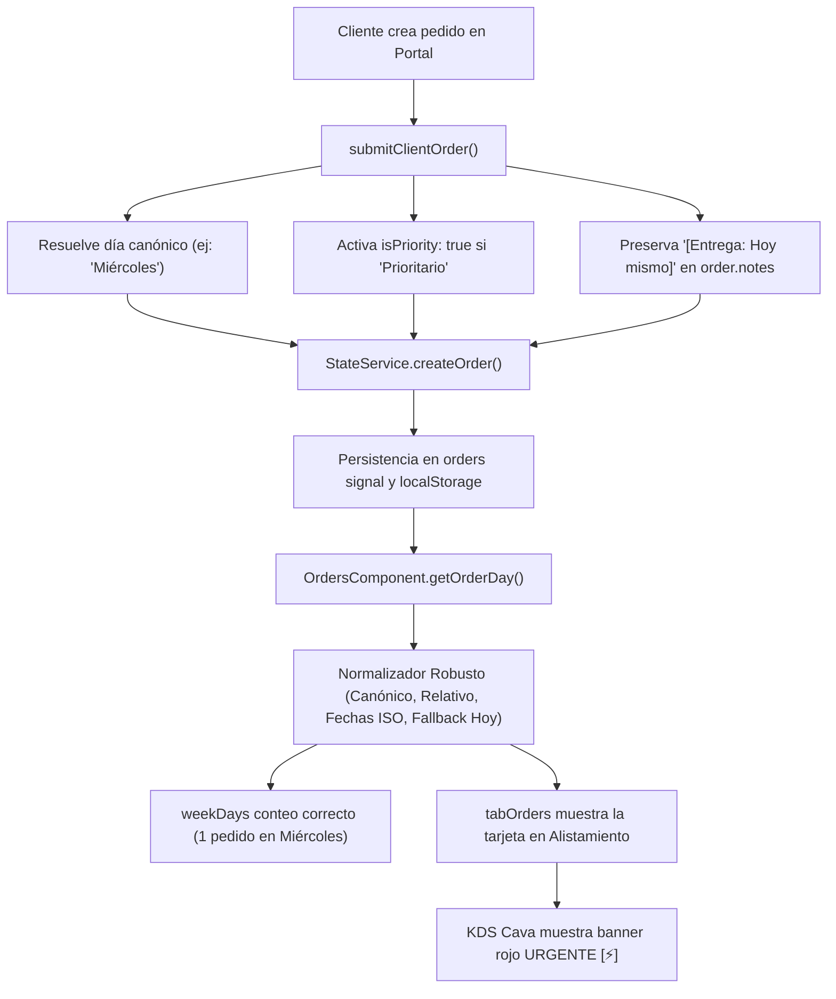

# 📋 Plan de Implementación: Visibilidad y Sincronización de Pedidos del Portal de Clientes en Alistamiento de Pedidos

## 📌 Contexto y Diagnóstico
Al crear un pedido desde el Portal de Clientes (`ClientPortalComponent`), el sistema registra la orden en `StateService` y actualiza el contador global de pendientes (reflejado en el badge `[ 1 ]` de la barra lateral en *Pedidos y Despachos*). Sin embargo, en la pantalla de **Alistamiento de Pedidos** (`OrdersComponent` - subtab picking), las 7 tarjetas de días de la semana marcan `0 pedidos` y la lista permanece vacía con el mensaje de estado *"¡Inventario al día! No hay pedidos pendientes de alistamiento"*.

### 🔍 Causa Raíz Identificada
1. **Desalineación de Cadenas de Día (`scheduledDay`)**:
   - En `ClientPortalComponent`, el selector de entrega ofrece opciones relativas: `'Hoy mismo (Prioritario)'`, `'Mañana a primera hora'`, `'Día Siguiente'`, `'Programado fin de semana'`.
   - Al invocar `createOrder`, se enviaba literalmente esa cadena a `order.scheduledDay`.
   - En `OrdersComponent`, las 7 columnas y pestañas de alistamiento están configuradas exclusivamente con los nombres canónicos en español: `['Lunes', 'Martes', 'Miércoles', 'Jueves', 'Viernes', 'Sábado', 'Domingo']`.
   - El método `OrdersComponent.getOrderDay(order: OrderDto)` retornaba de forma cruda `return order.scheduledDay || ''`.
   - Al comparar `'Hoy mismo (Prioritario)' === 'Miércoles'` (o cualquiera de los 7 días), el resultado es `false`. Por tanto, el pedido no encajaba en ninguna columna y resultaba invisible.
2. **Flag de Prioridad Urgente (`isPriority`)**:
   - Cuando el cliente seleccionaba `'Hoy mismo (Prioritario)'`, no se encendía el flag `isPriority: true` del pedido en `StateService`, impidiendo que se active la alerta roja de cava y ruta establecida en la regla de negocio 6.2.

---

## 🎯 Arquitectura de Solución (Estrategia de Doble Defensa)

---

## 🛠️ Alcance Quirúrgico de los Cambios

### 1. `src/app/core/services/state.service.ts`
- **Firma de `createOrder`**:
  - Incorporar el parámetro opcional `isPriority?: boolean` en `createOrder(orderData: { ... })`.
  - En la creación del objeto `newOrder: OrderDto`, asignar `isPriority: Boolean(orderData.isPriority)`.
  - Si `orderData.scheduledDay` viene vacío o indefinido, asignar por defecto el día de la semana actual mediante una función auxiliar limpia.
  - Sincronizar `isPriority` y `scheduledDay` en el payload de `this.api.createOrder(...)`.

### 2. `src/app/features/client-portal/client-portal.component.ts`
- **Resolución Canónica en `submitClientOrder()`**:
  - Crear el método privado `resolveCanonicalDay(deliveryOption: string): string` que mapea:
    - Opciones que contengan `'hoy'` o `'prioritario'` $\to$ Día actual en español (`Lunes` ... `Domingo`).
    - Opciones que contengan `'mañana'` o `'siguiente'` $\to$ Día siguiente en español.
    - Opciones que contengan `'fin de semana'` $\to$ `'Sábado'`.
    - Días explícitos $\to$ Normalización estándar.
  - Detectar `isPriority = rawDeliveryDay.toLowerCase().includes('prioritario');`.
  - Preservar la instrucción original en las notas: `[Entrega: ${rawDeliveryDay}]`.
  - Pasar `scheduledDay: resolvedWeekday` e `isPriority` a `stateService.createOrder(...)`.

### 3. `src/app/features/orders/orders.component.ts`
- **Normalización Robusta y Retrocompatible en `getOrderDay(order: OrderDto)`**:
  - Robustecer el método `getOrderDay(order: OrderDto): string`:
    1. Si `order.scheduledDay` coincide con alguno de los 7 días de `weekDayConfigs` (ignorando mayúsculas/minúsculas y tildes), retornar el nombre canónico correspondiente.
    2. Si contiene `'hoy'` o `'prioritario'`, retornar el día actual (`this.getCurrentWeekDayName()`).
    3. Si contiene `'mañana'`, `'manana'` o `'siguiente'`, retornar el día de mañana.
    4. Si contiene `'fin de semana'`, retornar `'Sábado'`.
    5. Si es una fecha ISO (`YYYY-MM-DD` o ISO string), parsearla y calcular su día de la semana.
    6. Si está vacío o no coincide con nada, usar `order.createdAt` / `order.orderDate` o fallback al día actual (`this.getCurrentWeekDayName()`).
  - **Efecto Inmediato**: El pedido ya creado por el usuario en su sesión actual (que quedó guardado como `'Hoy mismo (Prioritario)'`) **se hará visible de inmediato en la columna del día de hoy** sin requerir borrar la base de datos o recrear el pedido.

---

## 🧪 Estrategia de Pruebas Unitarias (`100% PASS`)

### 1. `src/app/core/services/state.service.spec.ts`
- Test: `should assign isPriority when provided to createOrder and default scheduledDay to current weekday`.

### 2. `src/app/features/client-portal/client-portal.component.spec.ts`
- Test: `should resolve canonical weekday and set isPriority true when selecting Hoy mismo (Prioritario) in client checkout`.

### 3. `src/app/features/orders/orders.component.spec.ts`
- Test: `should resolve relative phrases in getOrderDay (Hoy mismo, Mañana, Fin de semana) to canonical Spanish weekdays`.
- Test: `should filter client orders with relative scheduledDay into active weekday picking queue`.

---

## 🚫 Archivos NO Modificados
- `src/styles.scss` (No se tocan estilos globales).
- No se modifican contratos de API ni endpoints remotos.
- `delivery-map.component.ts`, `kds.component.ts`, `hr.component.ts` permanecen intactos.

---

## 🏁 Criterios de Aceptación
1. El pedido creado en el portal de clientes aparece de inmediato en la tarjeta de día correspondiente de **Alistamiento de Pedidos**.
2. El contador de la tarjeta de día (ej: `Miércoles`) se incrementa a `1 pedidos` y el resumen de pulpas requeridas se calcula automáticamente.
3. El flag `isPriority` se preserva para alertar en cava y despachos.
4. `npm run build` compila con 0 errores.
5. `npm test` pasa con 100% de éxito (202+ tests aprobados, 0 fallos).
6. Cero `git commit` y cero `git push`.
