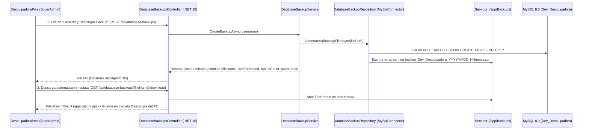

# 🛠️ PLAN MAESTRO DE ARQUITECTURA: AUDITORÍA PUNTO POR PUNTO, REVISIÓN PAR Y MÓDULO SUPERADMIN DE BACKUPS DE BD EN 1 CLIC

> [!IMPORTANT]
> **CERTIFICACIÓN DE LOS 3 SUB-AGENTES Y REGLAS ESTRICTAS (`AGENTS.md`)**:
> 1. **Reglas Actualizadas en `AGENTS.md`**: Queda **estrictamente prohibido** crear, eliminar o ejecutar migraciones (`dotnet ef migrations` / `dotnet ef database update`) y **estrictamente prohibido** ejecutar `git commit` o `git push`.
> 2. **[Agente 1 — Auditor Punto por Punto de Ejecución](conversation://64a3be33-566b-47a3-baa6-133ff8db80a8)**: Inspeccionó ítem por ítem todo lo implementado en `ApiDespulpadora` y `DespulpadoraPwa`.
> 3. **[Agente 2 — Revisor Par y Planificador (Peer Reviewer)](conversation://4aca49f9-6d5c-4af0-8786-69d86c2aaf53)**: Recibió la confirmación del Agente 1 y realizó la revisión par cruzada entre Controladores/DTOs de C# y Servicios/Componentes de Angular.
> 4. **[Agente 3 — Analista de Viabilidad de Backups de BD](conversation://887e15f1-b2ea-4277-80ad-23c9130d5365)**: Validó la viabilidad técnica 100% nativa en .NET 10 + MySQL + Docker/Coolify + Angular 20 para generar copias de seguridad `.sql` en un solo clic, almacenarlas en el servidor y descargarlas inmediatamente al PC local.

---

## ❓ SECCIÓN 1: DUDAS Y DECISIONES ARQUITECTÓNICAS PARA RESOLVER POR EL USUARIO

Antes de proceder a ejecutar este plan en la siguiente sesión, por favor indícanos tu preferencia sobre estos **5 puntos clave**:

1. **Ubicación Visual del Módulo de Copias de Seguridad en `DespulpadoraPwa`**:
   - **Opción A (Recomendada)**: Crearlo como un módulo independiente en el menú lateral bajo la sección `CONFIGURACIÓN MAESTRA` (`/admin/backups` — *"Copias de Seguridad BD"*) y además accesible desde una pestaña dentro de `/admin/catalog`.
   - **Opción B**: Integrarlo únicamente como una pestaña dentro del actual `Catálogo Maestro del Sistema` (`/admin/catalog`).
2. **Formato del Archivo de Backup (`.sql` puro vs `.zip` comprimido)**:
   - ¿Prefieres que el archivo almacenado en el servidor y descargado al ordenador sea directamente el script **`.sql` en texto plano** (listo para ejecutar en MySQL Workbench / DBeaver / CLI) o comprimido en **`.zip` (con el `.sql` adentro)** para ahorrar espacio en el servidor? *(Podemos dejar `.sql` por defecto).*
3. **Política de Retención Automática en el Servidor (`/app/Backups`)**:
   - Dado que cada clic guarda una copia física en el servidor, ¿deseas establecer un **límite automático de copias retenidas** (ej. conservar los **últimos 20 o 30 backups** y eliminar automáticamente el más antiguo al superar el límite), o conservar todos indefinidamente hasta que el SuperAdmin los elimine manualmente desde la tabla de historial en pantalla?
4. **Alcance del Script Canónico `Scripts/01_Clean_All_Tables.sql`**:
   - Actualmente `01_Clean_All_Tables.sql` utiliza `TRUNCATE TABLE` sobre las tablas activas (vaciando datos sin borrar las tablas) y `DROP TABLE IF EXISTS` solo para tablas viejas. ¿Deseas que `01_Clean_All_Tables.sql` haga **`DROP TABLE IF EXISTS` de absolutamente todas las tablas** en orden relacional (como indica `AGENTS.md`), y que `02_Init_RBAC_Seed.sql` incluya los `CREATE TABLE IF NOT EXISTS` completos con todas las columnas nuevas?
5. **Migración Residual Previa (`20261025032635_FullStackOperationalAndRbacSync.cs`)**:
   - Antes de establecerse la prohibición absoluta de migraciones, se había generado el archivo `20261025032635_FullStackOperationalAndRbacSync.cs`. ¿Deseas que eliminemos ese archivo `.cs` del repositorio para que tú gestiones las migraciones 100% manualmente, o lo conservamos tal como está?

---

## 🔍 SECCIÓN 2: HALLAZGOS DE LA AUDITORÍA PUNTO POR PUNTO (AGENTE 1) Y REVISIÓN PAR (AGENTE 2)

### 2.1 Lo que fue Verificado como 100% Correcto (`[OK]`)
- **Arquitectura Hexagonal en `ApiDespulpadora`**: Separación limpia `Controller -> Service -> Repository`, `0` uso de `var`, `0` comentarios internos `//` en C#, `0` referencias a `CompanyId` / `BranchId` en entidades, y Healthcheck nativo para Coolify (`/health` + `HEALTHCHECK` en `Dockerfile`).
- **Construcción Dinámica de Navegación RBAC en `DespulpadoraPwa`**: `SidebarComponent`, `MobileNavComponent`, `permissionGuard`, `HasPermissionDirective`, `DynamicModulePlaceholderComponent` y `SystemCatalogComponent` compilando con `0` errores y pruebas unitarias en verde.

### 2.2 Hallazgos Detectados en Revisión Par que se Corregirán en Ejecución (`[TO FIX]`)

| # | Severidad | Capa / Archivo | Hallazgo Detectado por Agentes 1 y 2 | Solución Quirúrgica en el Plan |
| :--- | :--- | :--- | :--- | :--- |
| **1** | **CRÍTICO** | `AuthResponseDto.cs` / `AuthService.cs` vs `auth.service.ts` | `AuthResponseDto` en el backend devuelve propiedades planas (`UserId`, `Username`, `FullName`, `Email`, `RoleId`, `RoleName`, `IsSystemDeveloper`) sin el objeto anidado `User`, mientras que `auth.service.ts` (`persistLoginSession`) lee `response.user.id`, provocando `TypeError` al iniciar sesión contra el API real. | 1) Agregar `public AuthenticatedUserDto? User { get; set; }` en `AuthResponseDto.cs` y poblarlo en `AuthService.cs`. 2) Hacer que `persistLoginSession` en `auth.service.ts` soporte tanto `response.user` como las propiedades planas de la raíz. |
| **2** | **ALTO** | `api.service.ts` & `state.service.ts` (Frutas y Stock) | `mapFruitFromApi` lee `item['stock100g']` en vez del diccionario `item['pulpStocks']` (`"100g"`, `"140g"`, `"250g"`, `"500g"`, `"1000g"`), y `adjustFruitStock` llama a `PATCH /api/fruits/{id}/stock` en lugar de `/api/fruits/{id}/fresh-stock` y `/api/fruits/{id}/pulp-stock`. | Alinear `mapFruitFromApi`, `adjustFruitStock` y `state.service.ts` (`adjustStock`, `adjustFreshFruitStock`) con los endpoints reales de `FruitsController.cs`. |
| **3** | **ALTO** | `api.service.ts` & `state.service.ts` (Lotes de Producción) | `createBatch` envía `seedAndPeelWasteKg` y `netPulpKg`, pero `CreateProductionBatchDto.cs` espera `wasteWeightKg` y `netPulpWeightKg`. | Alinear los nombres de propiedades en `createBatch` y `mapBatchFromApi` en `api.service.ts`. |
| **4** | **ALTO** | `api.service.ts` & `state.service.ts` (Pedidos y Picking) | `createOrder` / `updateOrder` envían `customerName`, `customerPhone`, `presentationGrams`, pero `CreateOrderDto` en C# exige `clientName`, `clientPhone`, `sizeKey`. Además `updateOrderItemPicking` llama a `/picking` en vez de `/picked`, y `state.service.ts` no invoca a `this.api` al crear/editar/eliminar pedidos. | Alinear payloads en `api.service.ts` (`clientName`, `clientPhone`, `sizeKey`, ruta `/picked`) y conectar `createOrder`, `updateOrder`, `deleteOrder`, `updateItemPickedQuantity` y `toggleOrderPriority` en `state.service.ts`. |
| **5** | **ALTO** | `api.service.ts` & `state.service.ts` (Clientes, Empleados y Turnos) | `createClient` envía `fullName` en lugar de `name`/`nit`; `createEmployee` envía `roleTitle`/`monthlySalary` en lugar de `position`/`baseMonthlySalary`; `getShifts` llama a `/api/accounting/closures` en lugar de `/api/employees/time-logs`. | Mapear explícitamente los payloads en `api.service.ts` y conectar `createClient`, `deleteClient`, `startWorkShift` y `closeWorkShift` en `state.service.ts`. |
| **6** | **MEDIO** | `PaymentMethodController.cs` & `IdentificationTypesController.cs` | Exponen las entidades `PaymentMethod` e `IdentificationType` directamente en vez de DTOs (`AGENTS.md` Regla 2.3), y métodos privados `MapToDto` / `IncrementStockUnitsAsync` carecen de `try-catch` (`AGENTS.md` Regla 3.3). | Crear `PaymentMethodDto` e `IdentificationTypeDto` y envolver todos los métodos privados en `try-catch`. |
| **7** | **MEDIO** | `Scripts/01_Clean_All_Tables.sql` & `02_Init_RBAC_Seed.sql` | `02_Init_RBAC_Seed.sql` omite la columna `Icon` en `PaymentMethods` e incluye datos quemados de 4 frutas (`AGENTS.md` Regla 4.4). | Corregir `INSERT INTO PaymentMethods` con `Icon`, retirar las frutas quemadas de negocio y agregar el módulo y acción de `Backups de Base de Datos`. |
| **8** | **MEDIO** | `DespulpadoraPwa` (Reglas `AGENTS.md` 3.4 y 4.1) | Limpiar comentarios HTML (`<!-- ... -->`) e internos `//` en archivos intervenidos, usar `permissionGuard` en `/admin/users` y `/admin/roles`, y completar pruebas unitarias `.spec.ts` de los servicios/componentes modificados. | Limpiar comentarios, usar `permissionGuard` en todas las rutas administrativas y agregar los `.spec.ts` faltantes. |

---

## 💾 SECCIÓN 3: DISEÑO ARQUITECTÓNICO DEL NUEVO MÓDULO SUPERADMIN DE COPIAS DE SEGURIDAD DE BD EN 1 CLIC (`DatabaseBackups`)

### 3.1 Estudio de Viabilidad Técnica (Agente 3)
- **Mecanismo Seleccionado**: **Motor Nativo de Volcado SQL por Streaming en .NET 10 (`MySqlConnector` + `SHOW CREATE TABLE` + Lotes `INSERT INTO`)**.
- **Por qué es la mejor arquitectura**:
  1. Funciona de forma **100% idéntica en Windows (Desarrollo Local) y en Contenedores Linux Docker (Coolify)** sin depender de binarios externos (`mysqldump` / `mariadb-dump`) que fallan por diferencias de versión o SSL contra MySQL 8.0.
  2. Utiliza exactamente la misma cadena de conexión `ConnectionStrings:DefaultConnection` configurada en `appsettings.json` / Coolify.
  3. Genera un archivo `.sql` estándar compatible con MySQL 8.0 (`SET NAMES utf8mb4; SET FOREIGN_KEY_CHECKS = 0;`, `DROP TABLE IF EXISTS` + `CREATE TABLE` + `INSERT INTO` por lotes + `SET FOREIGN_KEY_CHECKS = 1;`).

### 3.2 Componentes a Crear / Modificar en Backend (`ApiDespulpadora`)

1. **`ApiDespulpadora.Domain/Dtos/Options/BackupOptions.cs` [NUEVO]**:
   - Propiedades: `StoragePath` (`"Backups"`), `MaxRetainedBackups` (`20`).
2. **`ApiDespulpadora.Domain/Dtos/Backups/DatabaseBackupDtos.cs` [NUEVO]**:
   - `DatabaseBackupInfoDto`: `FileName`, `SizeBytes`, `SizeFormatted`, `DatabaseName`, `TablesCount`, `TotalRowsCount`, `DurationMs`, `CreatedAtUtc`, `CreatedByUsername`.
3. **`ApiDespulpadora.Domain/Interfaces/Repositories/IDatabaseBackupRepository.cs` [NUEVO]**:
   - `Task<(string DatabaseName, int TablesCount, long TotalRowsCount)> GenerateSqlDumpFileAsync(string outputFilePath);`
4. **`ApiDespulpadora.Domain/Interfaces/Services/IDatabaseBackupService.cs` [NUEVO]**:
   - `Task<DatabaseBackupInfoDto> CreateBackupAsync(string createdByUsername);`
   - `Task<IEnumerable<DatabaseBackupInfoDto>> GetStoredBackupsAsync();`
   - `Task<(Stream FileStream, string FileName)?> GetBackupStreamAsync(string fileName);`
   - `Task<bool> DeleteBackupAsync(string fileName);`
5. **`ApiDespulpadora.Infrastructure/Data/Repositories/DatabaseBackupRepository.cs` [NUEVO]**:
   - Implementa la extracción DDL + DML con `MySqlConnection`, `MySqlCommand`, `MySqlDataReader` y `StreamWriter` (UTF-8), con tipado explícito (cero `var`), `try-catch` completo y `/// 
`.
6. **`ApiDespulpadora.Core/Services/Backups/DatabaseBackupService.cs` [NUEVO]**:
   - Administra la carpeta `/app/Backups` (o `Backups` local), valida nombres de archivo contra *Path Traversal*, aplica retención máxima y mide duración y tamaño del archivo.
7. **`ApiDespulpadora/Controllers/DatabaseBackupsController.cs` [NUEVO]**:
   - Protegido con `[Authorize]` y validación de SuperAdmin (`IsSystemDeveloper || RoleId == 1` o permiso `backups.manage`):
     - `POST /api/database-backups` -> Crea el backup en el servidor y retorna `DatabaseBackupInfoDto`.
     - `GET /api/database-backups` -> Lista todos los backups almacenados en el servidor.
     - `GET /api/database-backups/{fileName}/download` -> Descarga el archivo `.sql` al navegador (`Content-Disposition: attachment`).
     - `DELETE /api/database-backups/{fileName}` -> Elimina un backup específico del servidor.
8. **`Dockerfile` y `Program.cs` [MODIFICAR]**:
   - En `Dockerfile`: Crear directorio `/app/Backups` en la imagen de producción (`RUN mkdir -p /app/Backups`).
   - En `Program.cs` / `RepositoryExtensions.cs` / `ServiceExtensions.cs`: Registrar `BackupOptions`, `IDatabaseBackupRepository` e `IDatabaseBackupService`.
9. **`ApiDespulpadora.UnitTests/Backups/DatabaseBackupServiceTests.cs` [NUEVO]**:
   - Pruebas unitarias con Moq validando creación de backup, listado en disco, descarga segura, bloqueo de Path Traversal y eliminación.

### 3.3 Componentes a Crear / Modificar en Frontend (`DespulpadoraPwa`)

1. **`src/app/core/models/business.models.ts` [MODIFICAR]**:
   - Agregar `DatabaseBackupInfoDto` (`fileName`, `sizeBytes`, `sizeFormatted`, `databaseName`, `tablesCount`, `totalRowsCount`, `durationMs`, `createdAtUtc`, `createdByUsername`).
2. **`src/app/core/services/api.service.ts` [MODIFICAR]**:
   - Agregar `getDatabaseBackups()`, `createDatabaseBackup()`, `downloadDatabaseBackup(fileName: string): Observable<Blob>` y `deleteDatabaseBackup(fileName: string)`.
3. **`src/app/features/admin/backups/backups.component.ts` & `.html` [NUEVO]** (y pestaña integrada en `SystemCatalogComponent`):
   - **Acción en 1 Clic (`"Generar y Descargar Copia de Seguridad Ahora"`)**:
     1. Invoca `POST /api/database-backups` mostrando estado de progreso (`Generando volcado SQL en el servidor...`).
     2. Al completarse, actualiza la tabla de copias alojadas en el servidor y **dispara automáticamente la descarga del archivo `.sql` al computador local** mediante `downloadDatabaseBackup(res.fileName)` + `URL.createObjectURL(blob)`.
   - **Tabla de Historial en el Servidor**:
     - Muestra nombre del archivo, fecha/hora, peso formateado (`KB`/`MB`), cantidad de tablas/filas respaldadas, botón **"Descargar al PC"** y botón **"Eliminar del Servidor"**.
   - 100% basado en clases globales de `src/styles.scss` (`card`, `table-container`, `data-table`, `btn-primary`, `badge`).
4. **`src/app/features/admin/backups/backups.component.spec.ts` [NUEVO]**:
   - Pruebas unitarias verificando la generación en 1 clic, descarga automática de Blob, listado del servidor y eliminación.
